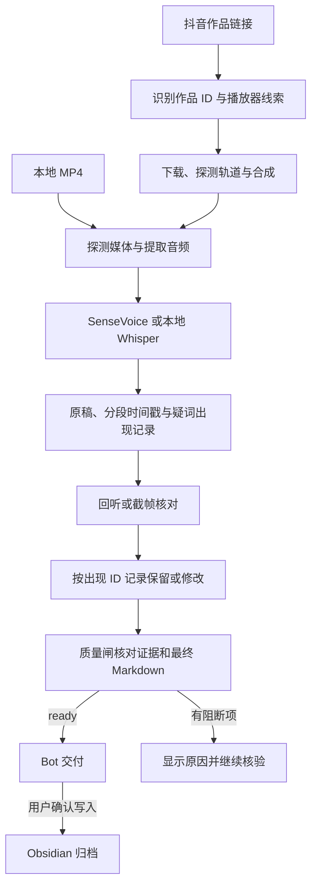

# douyin-transcribe-text 架构设计

这个 Skill 接收抖音作品链接或本地 MP4，生成可复核的口播逐字稿。脚本负责获取媒体、语音识别、记录证据和执行交付检查。Agent 或 Bot 负责回听、看帧、确认修订和交付。Obsidian 归档由调用方在用户明确确认后执行。

## 从输入到逐字稿

1. **取源。** `scripts/transcribe.py` 解析分享链接并在隔离浏览器中打开作品页。它比较精确的作品 ID、播放器可识别的来源和时长，再用 FFprobe 核对候选流。独立音视频流可合成 MP4。链接和时长吻合只能辅助确认，媒体无法与播放器直接关联时会要求核对来源。
2. **转写。** FFmpeg 提取 16 kHz 单声道 WAV。`auto` 有可用凭证时优先尝试 SenseVoice，失败或超限后尝试本地 Whisper。`--engine whisper` 将语音识别限定在本机。脚本记录取源、下载、合成和转写耗时。SenseVoice 当前返回全文，本地 Whisper 还会保存分段时间戳。
3. **核验。** 词表和启发式规则找出疑词。每一处以原稿字符范围为 ID，并尽量对应到 ASR 分段。Agent 用原音确认说法，用同一时点的字幕或界面确认拼写。在同一分段内重复出现的词仍需回听区分。
4. **交付。** 用证据记录生成审核后的正文，按需加标题与属性。质量闸用原稿与已批准修订重建正文，核对来源、原稿、证据指纹、必填属性和实际稿件。它允许空白与分段标题变化，并会拦住正文中未核验的改动或遗漏。

## 文件分工

| 代码 | 职责 |
|---|---|
| `scripts/transcribe.py` | CLI 入口、抖音取源、本地媒体处理、ASR 和草稿输出 |
| `scripts/naming.py` | 文件名规范、作品属性与 `meta.json` |
| `scripts/review.py` | 原稿和媒体指纹、疑词出现 ID、核验记录校验与正文重建 |
| `scripts/verify_terms.py` | 按出现 ID 或时点抽取全帧和字幕条，并写证据清单 |
| `scripts/quality_gate.py` | PyYAML 属性校验、交付状态、最终正文比对和可选可读性提示 |
| `scripts/ocr_vision.swift` | macOS 上可选的本机 OCR。Agent 或用户结合实际口播解读 |
| `scripts/feishu_send_file.py` | 单独运行的飞书文件交付适配，按调用方授权执行 |
| `scripts/rename_folders.py` | 已有媒体目录的批量整理工具 |
| `SKILL.md` 与 `references/` | Agent 触发条件、操作步骤、证据要求和交付约定 |

## 一个任务目录里的产物

| 文件 | 用途 |
|---|---|
| 作品 MP4 与 `meta.json` | 链接入口保留媒体并记录作品 ID、标题与来源 |
| `transcript_raw.md` | 保留 ASR 原始输出 |
| `transcript_segments.json` | 引擎与分段时间戳。纯文本引擎的分段数组为空 |
| `transcript_review.json` | 媒体路径、原稿和媒体 SHA‑256、来源状态、疑词出现记录 |
| `frames/manifest.json` | 按出现 ID 关联帧、时点和帧文件指纹 |
| `review_decisions.json` | Agent 或用户逐处记录证据、保留或修改，必要时确认媒体与出处一致 |
| `transcript.md` | 初始为草稿。调用方应用已核验的修改并通过质量闸后交付 |

运行时可用 `--output` 指定产物位置。下载任务可通过 `OPENCLAW_MEDIA_ROOT` 设置默认媒体根目录。归档前保留原稿、媒体、帧及核验记录，才能继续核查。遇到转写中断，可以从已保存的 MP4 走本地文件入口继续。

## Bot 接入约定

转写 CLI 的 `ok` 表示执行完成。交付方读取 `status` 来决定动作。

| 状态 | Bot 可采取的动作 |
|---|---|
| `needs_review` | 展示待核验原因，安排核对或标为草稿 |
| `needs_source_confirmation` | 核对下载媒体与作品来源，再记录确认 |
| `no_speech` | 告知疑似无口播，安排回听 |
| `needs_media` | 请提供有效的音视频或链接 |
| `failed` | 根据错误与阶段耗时处理运行故障 |
| `ready` | 质量闸退出码为 0，可交付终稿。Vault 写入另需用户明确确认 |

接入方调用 `quality_gate.py <transcript.md> --type speech --json` 获取状态和 `blockers`，自行实现消息格式、进度显示、发送与归档。完整命令和校验记录示例见 [核验与交付规范](../references/delivery-gate.md)。

## 已知边界

- 当前接收抖音链接和本地 MP4。扩展平台时，可替换取源模块，继续复用转写、核验和质量闸。
- 页面可能预载不同作品，等长文件也可能来自推荐内容。缺少关联证据时需要确认来源。
- 帧校验程序能证明文件、时点和记录相符。实际口播、字幕和画面是否支持修订，由查看证据的人或 Agent 判断。
- 这个仓库提供 Skill 和 CLI。队列、跨机器调用、访问控制与新会话刷新由实际宿主处理。
